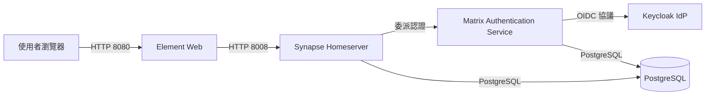

# OurChat — 自架 Matrix 即時通訊系統

基於 Matrix 開源協議架設之企業 / 小團隊內部即時通訊平台。本專案著重於**資料自主權**、**端到端加密（E2EE）**與**現代化身分驗證（OIDC）**整合，支援 Web、桌面與行動端存取。

詳細的技術決策、架構評估與踩坑紀錄請參閱 [ROADMAP.md](file:///d:/Source/Private/ourchat/ROADMAP.md)。

---

## 系統架構

本專案現處於 **Phase 2（OIDC 整合驗證完成）** 階段，採用容器化架構部署下列核心元件：

| 服務元件 | 技術選型 / 映像檔 | 連接埠 (Host) | 內部 IP (ourchat 網路) | 說明 |
|---|---|---|---|---|
| **Web 客戶端** | `vectorim/element-web:latest` | `8080` | `172.28.0.14` | Element Web 前端介面 |
| **Homeserver** | `matrixdotorg/synapse:latest` | `8008` | `172.28.0.11` | Matrix 核心服務（`server_name: ourchat.local`） |
| **身分驗證服務** | `ghcr.io/element-hq/matrix-authentication-service:latest` | `8081` | `172.28.0.13` | MAS（Matrix Authentication Service），OIDC 代理 |
| **IdP 身分識別** | `quay.io/keycloak/keycloak:latest` | `8082` | `172.28.0.12` | 開源身分識別與存取管理（提供 OIDC Provider） |
| **關聯式資料庫** | `postgres:16-alpine` | - | `172.28.0.10` | 提供 Synapse 與 MAS 之後端資料庫儲存 |



---

## 專案結構

```text
ourchat/
├── docker-compose.yml          # 容器服務編排設定
├── ROADMAP.md                  # 專案發展藍圖、技術評估與避坑指南
├── README.md                   # 專案說明文件（本檔案）
├── .gitignore                  # Git 排除清單（排除資料庫檔案與媒體暫存）
├── element-config/
│   └── config.json             # Element Web 前端組態
├── mas-data/
│   └── config.yaml             # MAS 認證服務組態檔
└── synapse-data/
    ├── homeserver.yaml         # Synapse 核心組態檔
    ├── ourchat.local.log.config# 日誌輸出組態
    └── ourchat.local.signing.key# Synapse 簽署金鑰
```

> **注意**：`pg-data/`、`keycloak-data/` 及 `synapse-data/media_store/` 為執行期持久化資料目錄，已被 `.gitignore` 排除。

---

## 快速開始（本地 PoC 環境）

### 1. 前置需求

- [Docker Desktop](https://www.docker.com/)（支援 Docker Compose v2）
- 確保連接埠 `8008`, `8080`, `8081`, `8082` 未被其他本機服務佔用

### 2. 啟動服務

於專案根目錄執行：

```bash
docker compose up -d
```

檢視各容器啟動狀態：

```bash
docker compose ps
```

### 3. 存取各服務

- **Element Web（聊天前端）**：[http://localhost:8080](http://localhost:8080)
- **Keycloak 管理後台**：[http://localhost:8082](http://localhost:8082)
  - 管理員帳號：`admin`
  - 管理員密碼：`admin`
- **MAS 認證服務端點**：[http://localhost:8081](http://localhost:8081)
- **Synapse API**：[http://localhost:8008](http://localhost:8008)

### 4. 登入體驗流程

1. 開啟瀏覽器造訪 [http://localhost:8080](http://localhost:8080)（Element Web）。
2. 點擊登入按鈕，系統會自動導向 MAS 認證頁面（[http://localhost:8081](http://localhost:8081)）。
3. 選擇以 Keycloak 登入，跳轉至 Keycloak Realm 登入介面（[http://localhost:8082](http://localhost:8082)）。
4. 輸入帳號密碼登入後，MAS 會自動讀取使用者資訊並於 Synapse 建立對應帳號（如 `@username:ourchat.local`），最後安全導回 Element Web 開始通訊。

---

## 路線圖演進與規劃

- [x] **Phase 1：最小可行 PoC**
  - Synapse + PostgreSQL + Element Web 基本通訊驗證完成。
- [x] **Phase 2：加入 OIDC 身分驗證**
  - 整合 MAS 與 Keycloak，完成單一登入與自動佈署帳號機制。
- [ ] **Phase 3：語音與視訊通話**
  - 規劃部署 LiveKit SFU + coturn（TURN 伺服器），整合 Element Call。
- [ ] **Phase 4：正式化與維運規劃**
  - 遷移 S3/MinIO 物件儲存、資料庫備份還原機制、推播服務（Sygnal + APNs/FCM）。
